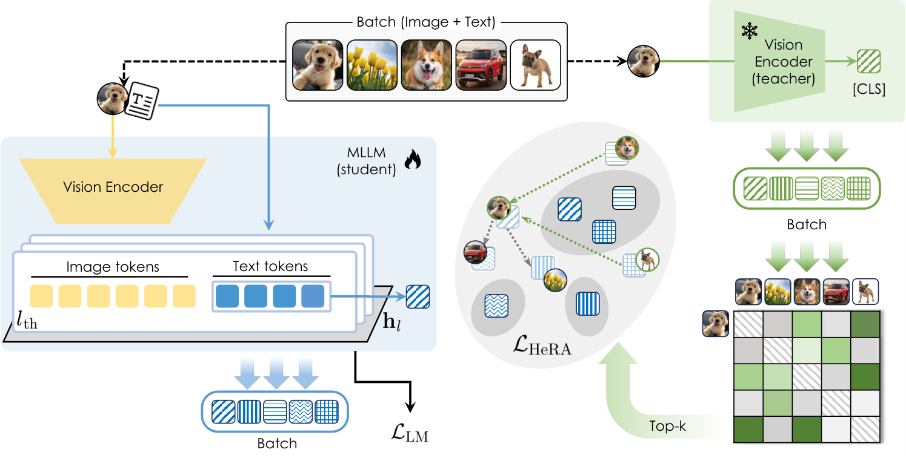

<div align="center">
  <h1> Mind the Heads: <br>Topological Representation Alignment for Multimodal LLMs</h1>
</div>

<div align="center">

  [](https://arxiv.org/abs/2606.23885)
  [](https://huggingface.co/collections/aimagelab/hera-6a06c9df4edfff8cbb61afe9)
  [](https://huggingface.co/aimagelab/HeRA_GranD)

</div>

<p align="center">
  
</p>

## Table of Contents

1. [Installation](#installation)
2. [Checkpoints](#checkpoints)
3. [Usage](#use-with-s-transformers)
4. [MKNN Analysis](#mknn-analysis)
5. [Training](#training)
6. [Evaluation](#evaluation)
7. [Citation](#citation)

## Installation

1. Create the Python environment.
```bash
conda create -n hera -y python=3.11
conda activate hera
```
2. Clone the repo and install the dependencies.
```bash
git clone https://github.com/aimagelab/HeRA.git
cd HeRA
pip install -r requirements.txt
```

**Note:** `requirements.txt` pins the AMD/ROCm PyTorch builds we used on the [LUMI](https://www.lumi-supercomputer.eu/) HPC cluster. On NVIDIA GPUs, first install the PyTorch build for your CUDA version, then remove the `+rocm` packages (`torch`, `torchvision`, `torchaudio`, `torchao`, `pytorch-triton-rocm`) from `requirements.txt` before installing the rest.

The code imports `src` as a top-level package (`from src.models import ...`) and is not installed with `pip install -e`. Run every command from the repo root with `PYTHONPATH=.` set.

## Checkpoints

All checkpoints use [SigLIP2-SO400M/14@384](https://huggingface.co/google/siglip2-so400m-patch14-384) as the vision encoder and were trained on [LLaVA-v1.5](https://github.com/haotian-liu/LLaVA) data. They are in the [🤗 HeRA collection](https://huggingface.co/collections/aimagelab/hera-6a06c9df4edfff8cbb61afe9).

| Checkpoint | Base LLM | `conv_mode` |
| --- | --- | --- |
| [aimagelab/HeRA-Qwen2.5-3B-SigLIP2](https://huggingface.co/aimagelab/HeRA-Qwen2.5-3B-SigLIP2) | [Qwen2.5-3B-Instruct](https://huggingface.co/Qwen/Qwen2.5-3B-Instruct) | `qwen2_5` |
| [aimagelab/HeRA-Qwen2.5-7B-SigLIP2](https://huggingface.co/aimagelab/HeRA-Qwen2.5-7B-SigLIP2) | [Qwen2.5-7B-Instruct](https://huggingface.co/Qwen/Qwen2.5-7B-Instruct) | `qwen2_5` |
| [aimagelab/HeRA-Qwen3-4B-SigLIP2](https://huggingface.co/aimagelab/HeRA-Qwen3-4B-SigLIP2) | [Qwen3-4B-Instruct-2507](https://huggingface.co/Qwen/Qwen3-4B-Instruct-2507) | `qwen3_inst` |
| [aimagelab/HeRA-Qwen3-8B-SigLIP2](https://huggingface.co/aimagelab/HeRA-Qwen3-8B-SigLIP2) | [Qwen3-8B](https://huggingface.co/Qwen/Qwen3-8B) | `qwen3` |
| [aimagelab/HeRA-Llama3-8B-SigLIP2](https://huggingface.co/aimagelab/HeRA-Llama3-8B-SigLIP2) | [Meta-Llama-3-8B-Instruct](https://huggingface.co/meta-llama/Meta-Llama-3-8B-Instruct) | `llama3` |

`conv_mode` is the conversation template used at training time. Pass the same value to the inference snippet below and to the evaluation scripts.

## Use with 🤗's Transformers

```python
import requests
import torch
from io import BytesIO
from PIL import Image
from transformers import AutoTokenizer, AutoImageProcessor

from src.models import MLLMForCausalLM, CONV_MAPPING, DEFAULT_IMAGE_TOKEN
from src.cambrian_eval_utils import process_images

model_id = 'aimagelab/HeRA-Qwen2.5-3B-SigLIP2'
conv_mode = 'qwen2_5'  # see the table above
device = 'cuda'

model = MLLMForCausalLM.from_pretrained(
    model_id,
    device_map=device,
    lm_kwargs=dict(torch_dtype=torch.bfloat16, attn_implementation='sdpa'),
)
tokenizer = AutoTokenizer.from_pretrained(model.config.text_config.name_or_path)
model.init_vision_tokenizer(tokenizer)
image_processor = AutoImageProcessor.from_pretrained(model.config.vision_config.name_or_path)

image_url = 'http://images.cocodataset.org/val2017/000000039769.jpg'
image = Image.open(BytesIO(requests.get(image_url).content)).convert('RGB')

conv = CONV_MAPPING[conv_mode].new_empty()
conv.add_sys_prompt()
conv.add_message(dict(role='user', content=f'{DEFAULT_IMAGE_TOKEN}\nDescribe this image in detail.'))
prompt = conv.get_prompt(add_generation_prompt=True)

input_ids = tokenizer(prompt, return_tensors='pt').input_ids.to(device)
pixel_values = process_images([image], image_processor, model.config.image_aspect_ratio).to(device)

with torch.inference_mode():
    output_ids = model.generate(input_ids, pixel_values=pixel_values, max_new_tokens=256, do_sample=False)

print(tokenizer.batch_decode(output_ids, skip_special_tokens=True)[0].strip())
```


## MKNN Analysis

MKNN analysis measures how well each attention head in a given LLM is aligned with the visual domain. The result is a heatmap of MKNN scores indexed by (layer, head), from which you select the 5 **least** aligned heads (i.e., the lowest MKNN scores) to use as HeRA targets (the `--ra_llm_layers_heads` argument at training time).

The scripts in `src/alignment/` and `scripts/alignment/` implement a three-step pipeline.

### Data

The [GranD](https://grounding-anything.com/) image-caption subset used in the paper is available at:

[**aimagelab/HeRA_GranD**](https://huggingface.co/aimagelab/HeRA_GranD)

Download and extract it:

```bash
# download HeRA_GranD.tar.gz from https://huggingface.co/aimagelab/HeRA_GranD
tar -xzf HeRA_GranD.tar.gz
```

The extracted directory has the following structure:

```
GranD/
  images/       # JPEG images (e.g. sa_10020.jpg, ...)
  annotations/  # per-image JSON annotations (e.g. sa_10020.json, ...)
```

Each annotation file contains a `dense_caption.caption` field with a text description of the corresponding image.

### Step 1 — Extract visual features

Extract DINOv2-Large features for the GranD images. Each image is encoded by the vision encoder and its `pooler_output` is saved.

```bash
python -u src/alignment/feats_img.py \
    --model_name_or_path facebook/dinov2-large \
    --image_root /path/to/GranD/images \
    --annotation_root /path/to/GranD/annotations \
    --output_path /path/to/output/features/visual
```

Output: `/path/to/output/features/visual/dinov2-large.safetensors`

A SLURM launcher is provided at [scripts/alignment/feats_img.sh](scripts/alignment/feats_img.sh).

### Step 2 — Extract LLM features

Extract layer-wise (and optionally head-wise) text features from the LLM you want to analyze. Each caption from the GranD dataset is encoded and the hidden states at each layer are pooled and saved.

**For a text-only LLM** (before multimodal training):

```bash
python -u src/alignment/feats_txt.py \
    --model_name_or_path Qwen/Qwen2.5-7B-Instruct \
    --annotation_root /path/to/GranD/annotations \
    --output_path /path/to/output/features/text/avg \
    --batch_size 1 \
    --pooling_mode avg \
    --headwise
```

The `--headwise` flag additionally extracts per-head features via `o_proj` hooks. For GQA models (e.g., Qwen, LLaMA), add `--headwise_gqa` to pool query heads down to key-value groups.

Output layout:

```
/path/to/output/features/text/avg/
  Qwen2.5-7B-Instruct/
    Qwen2.5-7B-Instruct__L0.safetensors
    Qwen2.5-7B-Instruct__L1.safetensors
    ...
  heads/
    Qwen2.5-7B-Instruct/
      Qwen2.5-7B-Instruct__L0.safetensors   # shape: (N, n_heads, D)
      ...
```

A SLURM launcher is provided at [scripts/alignment/feats_txt.sh](scripts/alignment/feats_txt.sh) (supports job arrays over multiple LLMs).

**For a trained MLLM checkpoint** (after stage 1 or stage 2):

```bash
python -u src/alignment/feats_txt_mllm.py \
    --checkpoint_path /path/to/checkpoint \
    --image_root /path/to/GranD/images \
    --annotation_root /path/to/GranD/annotations \
    --output_path /path/to/output/features/mllm/avg \
    --pooling_mode avg \
    --conv_template plain \
    --headwise
```

When `--conv_template plain`, the caption is fed as `<image>\n{caption}` and only the post-visual tokens are pooled. When using an instruction template (e.g., `--conv_template qwen2_5`), only the assistant response tokens are pooled.

A SLURM launcher is provided at [scripts/alignment/feats_txt_mllm.sh](scripts/alignment/feats_txt_mllm.sh).

### Step 3 — Compute MKNN scores

Given the visual features and one set of text layer features, compute the Mutual k-Nearest Neighbor (MKNN) alignment scores across all layers (and heads, when head-wise features are provided).

**Layer-wise scores** (bar chart output):

```bash
python -u src/alignment/mknn.py \
    --feats_img_path /path/to/output/features/visual/dinov2-large.safetensors \
    --feats_txt_path /path/to/output/features/text/avg/Qwen2.5-7B-Instruct \
    --output_path /path/to/output/results \
    --k 10
```

**Head-wise scores** (heatmap output — layers × heads):

```bash
python -u src/alignment/mknn.py \
    --feats_img_path /path/to/output/features/visual/dinov2-large.safetensors \
    --feats_txt_path /path/to/output/features/text/avg/heads/Qwen2.5-7B-Instruct \
    --output_path /path/to/output/results/heads \
    --k 10 \
    --topk_heads 10
```

Output for each run:

- `mknn_k{k}__{vision_model}__{llm_name}.jpg` — bar chart (layer-wise) or heatmap (head-wise)
- `mknn_k{k}__{vision_model}__{llm_name}_metadata.json` — all (layer, head) pairs sorted by MKNN score in descending order

For example, for Qwen2.5-7B-Instruct the JSON looks like:

```json
{
  "mknn_scores": [
    ["L21H4", 0.207],
    ["L9H25", 0.200],
    ...
    ["L4H13", 0.023],
    ["L4H10", 0.022],
    ["L14H4", 0.017],
    ["L4H7",  0.016],
    ["L14H5", 0.013]
  ]
}
```

From this ranking, select the 5 least aligned heads, i.e., the **last** 5 entries, to use as HeRA targets during training.

A SLURM launcher running both layer-wise and head-wise MKNN in sequence is provided at [scripts/alignment/mknn.sh](scripts/alignment/mknn.sh).

### Interpreting results and selecting heads

From the head-wise MKNN JSON, take the 5 (layer, head) pairs with the lowest scores (the last 5 entries). These are passed to the training script via the `--ra_llm_layers_heads` argument, using the following syntax:

```
"{layer_idx}:{head_idx1 head_idx2 ...} {layer_idx}:{head_idx1 ...}"
```

For example, `"3:4 5:9 10 14 15"` means layer 3 → head 4, and layer 5 → heads 9, 10, 14, and 15.

## Training

Training follows the standard LLaVA two-stage recipe. Scripts use DeepSpeed and are launched via SLURM + Singularity (`scripts/train/hera/`).

### Stage 1 — Projector pre-training

Only the MLP projector is trained. The LLM and vision encoder remain frozen. HeRA loss is applied to the selected heads from the start: this encourages projector weights to route visual information toward the heads identified by MKNN analysis.

```bash
sbatch scripts/train/hera/st1_hera.sh
```

Key arguments:

| Argument                            | Value                                                                                                       |
| ----------------------------------- | ----------------------------------------------------------------------------------------------------------- |
| `--train_proj_only`               | freeze LLM and vision encoder                                                                               |
| `--vision_model_name`             | `google/siglip2-so400m-patch14-384`                                                                       |
| `--tgt_vision_model_name`         | `facebook/dinov2-large`                                                                                   |
| `--tgt_projector_type`            | `identity`                                                                                                |
| `--ra_llm_layers_heads`           | `"3:4 5:9 11 14 15"` (LLM-specific)                                                                       |
| `--hera True`                     | enable HeRA contrastive loss                                                                                |
| `--hera_topk`                     | `10` (in-batch `k`-nearest neighbors per sample)                                                                      |
| `--hera_learn_logit_scale`        | learnable temperature                                                                                       |

The trained projector weights are saved as `projector.pt` in the output directory.

### Stage 2 — Instruction tuning with HeRA

The full model (LLM + projector) is fine-tuned on LLaVA instruction data. The HeRA loss continues to be applied to the same set of heads selected in stage 1.

```bash
sbatch scripts/train/hera/st2_hera.sh
```

Key additional arguments:

| Argument                | Value                                                      |
| ----------------------- | ---------------------------------------------------------- |
| `--load_proj_weights` | path to `projector.pt` from stage 1                       |
| `--conv_template`     | LLM-specific (e.g., `qwen2_5`, `llama3`, `vicuna_v1`) |

The script supports a job array (`SLURM_ARRAY_TASK_ID`) over multiple LLMs; see the `LLMS` array at the top of the script.

## Evaluation

Evaluation uses the [Cambrian](https://github.com/cambrian-mllm/cambrian) benchmark suite (23 benchmarks). The SLURM script runs one benchmark per array task; edit its placeholder paths (marked with `TODO`) for your cluster.

```bash
sbatch scripts/eval/cambrian/eval_cambrian.sh <model_path> <conv_mode> [output_dir]
```

`<model_path>` is a 🤗 Hub id (e.g., `aimagelab/HeRA-Qwen2.5-3B-SigLIP2`) or a local checkpoint directory. `<conv_mode>` must match the conversation template used at training time (e.g., `qwen2_5`, `llama3`, `vicuna_v1`).

Run a single benchmark:

```bash
bash scripts/eval/cambrian/eval_cambrian_single.sh --benchmark <bench> --ckpt <model_path> --conv_mode <conv_mode> --output_dir <output_dir>
```

### Hallucination benchmarks

Each benchmark has its own README with the data setup, python launch commands, and SLURM scripts:

- [AMBER](amber/README.md) (generative and discriminative tasks)
- [CHAIR-MSCOCO](chair_mscoco/README.md)
- [HallusionBench](hallusion/README.md)

We use greedy decoding, `bf16`, and `sdpa` attention, with up to 512 new tokens for CHAIR-MSCOCO and the AMBER generative task, and 3 for the AMBER discriminative task.

## Citation

```bibtex
@inproceedings{caffagni2026mind,
  title={{Mind the Heads: Topological Representation Alignment for Multimodal LLMs}},
  author={Caffagni, Davide and Compagnoni, Alberto and Melis, Federico and Sarto, Sara and Dovesi, Pier Luigi and Granroth-Wilding, Mark and Cornia, Marcella and Baraldi, Lorenzo},
  booktitle={Advances in Neural Information Processing Systems},
  year={2026}
}
```
